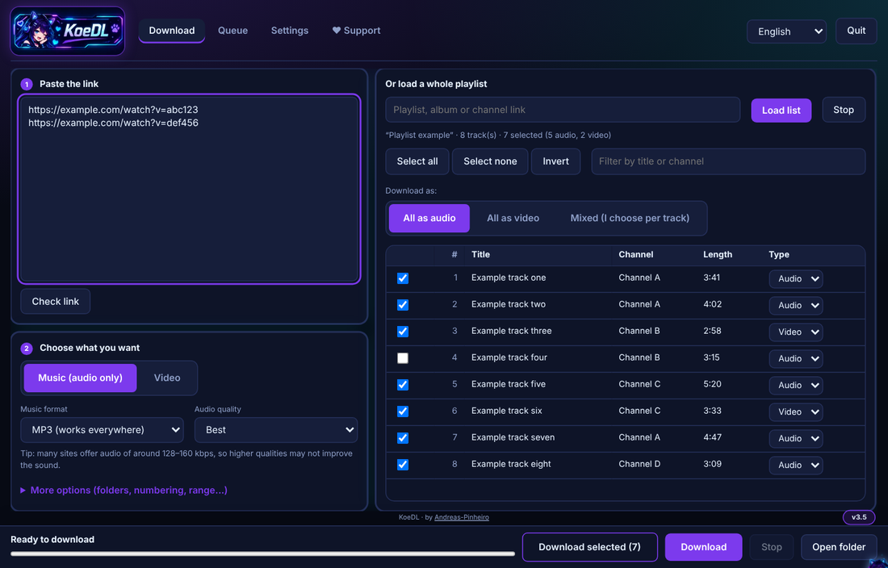
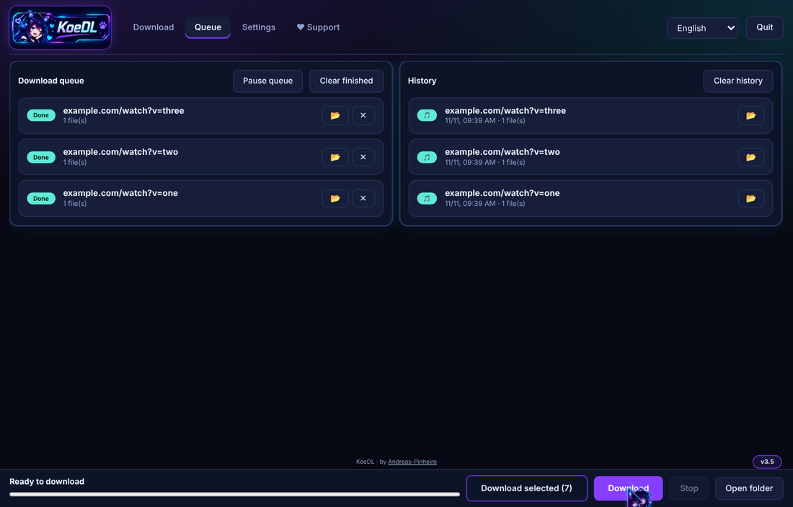
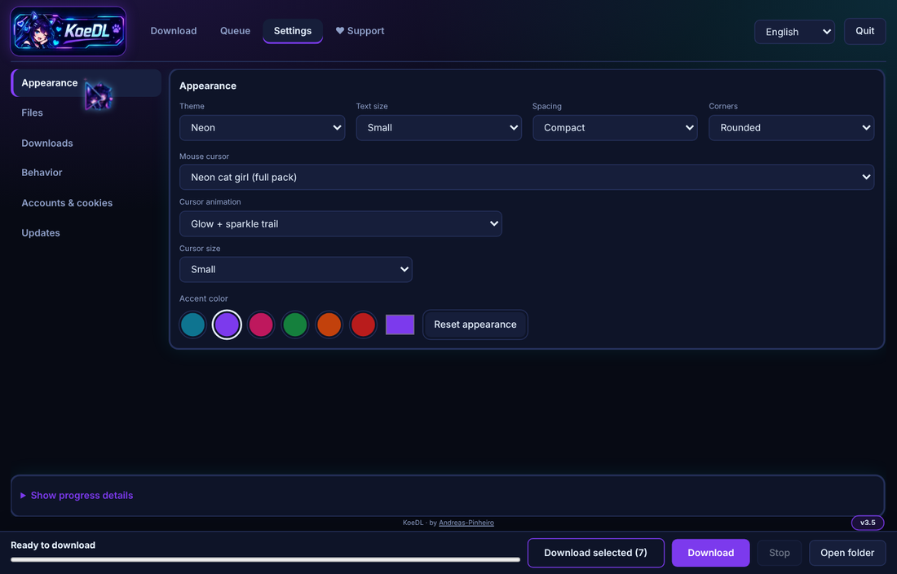
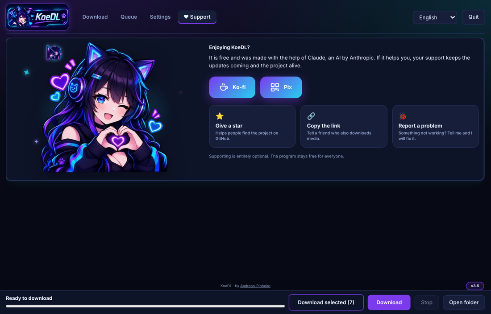

# KoeDL · Media-Downloader

**Free video and audio downloader for Windows (yt-dlp) - single file, no install needed.**

Keywords: video downloader, audio downloader, MP3 downloader, playlist downloader, yt-dlp GUI, Windows, WebView2.

**by Andreas-Pinheiro** · [Português](README.pt-BR.md)

Audio and **video downloader** for Windows in a **single file** (`Media-Downloader.bat`). It opens a local web interface, works with over a thousand sites, and keeps playlists organized in folders.

> **Status:** built and tested on Linux (backend on PowerShell 7 with the real yt-dlp, interface in Chromium). Tested by the author on Windows only lightly: the `.exe` build, browser cookie reading, process termination and shortcuts depend on Windows and may need adjustments. If something fails, open an *issue* with the error message.

## Screenshots

## Features

- **Music or video** from any site supported by [yt-dlp](https://github.com/yt-dlp/yt-dlp) (over a thousand; see its list of supported sites).
- **Audio:** MP3, M4A, Opus, FLAC or WAV, with quality choice and embedded cover art/metadata.
- **Video:** MP4 (H.264 + AAC, plays everywhere) or MKV (original, no conversion), with an optional resolution cap.
- **Organized playlists:** one folder named after the playlist (resumes where it stopped), a new folder every time (name + date and time), or no folder. When you paste several links, everything can go into a "Batch date-time" folder.
- **Playlist next to your links:** on the same tab you can paste links on the left and load a whole playlist on the right, tick the tracks and choose audio or video per track (all audio, all video, or mixed). Optional Music / Videos subfolders.
- **Resume:** remembers what was already downloaded and skips repeats. There is an option to start over.
- **Queue:** everything you add goes into a queue and runs one after the other; pause, remove or retry items. Add more while it is downloading.
- **History:** every finished download is listed, with a button to show the file in its folder.
- **Speed limit and connections** per file, separate folders for music and videos, and a Windows notification (or close the program / shut down the PC) when the queue finishes.
- **Handy extras:** the copied link is pasted by itself when you open the program, you can drag links into the window, and there are keyboard shortcuts (Ctrl+Enter downloads, Ctrl+L focuses the link box, Ctrl+1..4 switch tabs).
- **Themes:** Neon, Midnight, Forest, Sakura, light, dark, plus accent colors and a custom cat-girl cursor.
- **Blocked or removed videos:** looks for an alternative version and lists what could not be solved, with the reason.
- **Cookies:** rotates between Firefox, Edge, Chrome, Brave, Opera and Vivaldi when one fails or gets blocked. Also accepts a `cookies.txt` next to the program.
- **Always up to date:** yt-dlp is updated every time the program opens (stable or nightly channel). ffmpeg and deno are checked now and then. If a download fails because of an outdated extractor, it updates and retries on its own. Dependency downloads retry with increasing waits and fall back to an alternative address.
- **Shortcuts on the first run:** creates Desktop and Start Menu shortcuts by itself (once) and points them to the `.exe` as soon as it is built. Taskbar pinning cannot be automated by Windows: right-click the shortcut > *Pin to taskbar*.
- **Self-updating:** besides yt-dlp/ffmpeg/deno, the program checks this repository when it opens and downloads newer versions of itself (works with the `.bat` and the `.exe`; can be turned off in Settings).
- **Language:** opens in English; switch to Portuguese with the selector at the top. Your choice is remembered.
- **Builds an `.exe`:** when you open the `.bat`, it tries to create `KoeDL.exe` next to it, with an icon and tray menu. A button in Settings creates Desktop and Start Menu shortcuts.

## How to use

1. Download `Media-Downloader.bat` and put it in a folder of your own (for example `C:\KoeDL`).
2. Double-click it. The first time it downloads yt-dlp, ffmpeg and deno (needs internet and access to GitHub).
3. The app opens in its own window (Microsoft Edge WebView2, downloaded automatically; if the Windows runtime is missing, it asks to install the latest one). Edge/Chrome in app mode is only a fallback. Paste the links and click **Download**. The window remembers its size and position.
4. Files go to `Downloads` next to the program (changeable in Settings).

If Windows SmartScreen warns you, it is because the file is not signed: click *More info* and *Run anyway*. If your antivirus complains about the `.exe`, use the `.bat`, which does the same thing.

Files created next to the program: `bin\` (helper programs, `settings.json`, download history in `archives\`), `Downloads\` and, if built, the `.exe`.

## Technologies

| Piece | Purpose |
|---|---|
| **Batch (`.bat`) + PowerShell 5.1** | Single file: the `.bat` reads itself and runs the PowerShell part without depending on the script execution policy |
| **PowerShell `HttpListener`** | Local web server (`127.0.0.1` only, ports 8765-8789) with a per-run token and `Host` header check |
| **PowerShell runspaces** | Download, playlist loading and updates in the background without freezing the interface |
| **Plain HTML + CSS + JavaScript** | Interface embedded in the file itself, automatic light/dark theme, English/Portuguese |
| **[yt-dlp](https://github.com/yt-dlp/yt-dlp)** | Extraction and download |
| **[FFmpeg](https://ffmpeg.org/)** (yt-dlp builds) | Conversion, merging audio and video, embedded cover art |
| **[Deno](https://deno.com/)** | Runs the JavaScript some sites require today |
| **C# 5 + `CSharpCodeProvider` (.NET Framework)** | Compiles the `.exe` launcher with a tray icon, right on the user's machine |
| **WScript.Shell** | Shortcut creation |

## How it works inside

- The `.bat` extracts the text after the `###PS###` marker and runs it as a script block.
- Each yt-dlp run uses a temporary UTF-8 config file, avoiding quoting and accent problems on the Windows command line.
- Progress comes from `--progress-template`; finished files from `--exec`.
- The playlist folder name is resolved before the download, because yt-dlp replaces `/` inside template fields.
- The history (`--download-archive`) is kept per link and per format/quality.
- The local API (`/api/...`) is simple and token-protected, leaving room for a browser extension or a standalone app in the future.

## Legal notice

Use it only to download content you have the right to download (yours, public domain, licensed, or authorized). Downloading some content may violate site terms of service or copyright laws in your country. The responsibility for use lies with the user. This project is not affiliated with YouTube, Google or any other site mentioned.

## Credits

All the heavy lifting is done by [yt-dlp](https://github.com/yt-dlp/yt-dlp), [FFmpeg](https://ffmpeg.org/) and [Deno](https://deno.com/), which have their own licenses. This project only orchestrates them.

---

Made by **[Andreas-Pinheiro](https://github.com/Andreas-Pinheiro)**.

## Installer

The first run also generates `KoeDL-Setup.exe`. Open it and choose:

- **Install on this PC** (shortcuts, Windows Apps entry, uninstall) or the **Portable version** (only copies the files to a folder; nothing is registered in Windows, great for a USB stick).
- **Where to put it**: use the default folder or click *Browse*.
- **Updating**: if KoeDL is already installed, the installer detects it and **replaces it** (your settings, history and queue are kept). No need to uninstall first.

> ⚠️ **Administrator:** the default folder (inside your user profile) does **not** need administrator rights. If you choose a protected folder (like `C:\Program Files`), you must **right-click `KoeDL-Setup.exe` > Run as administrator**. The installer also warns you and offers to reopen as administrator.

## Support the project

KoeDL is free and was built with the help of Claude, an AI by Anthropic. If it helps you, you can support it for free:

- ⭐ **Give the repository a star** at the top of this page.
- 🔗 **Share it** with a friend who also downloads media.
- ☕ **Buy me a coffee** on [Ko-fi](https://ko-fi.com/andreaspinheiro001).
- 🐞 **Report a problem** in the [Issues](https://github.com/Andreas-Pinheiro/Media-Downloader/issues) tab.

The same options (and the coffee button) are inside the app, in the **♥ Support** tab. Supporting is entirely optional.
