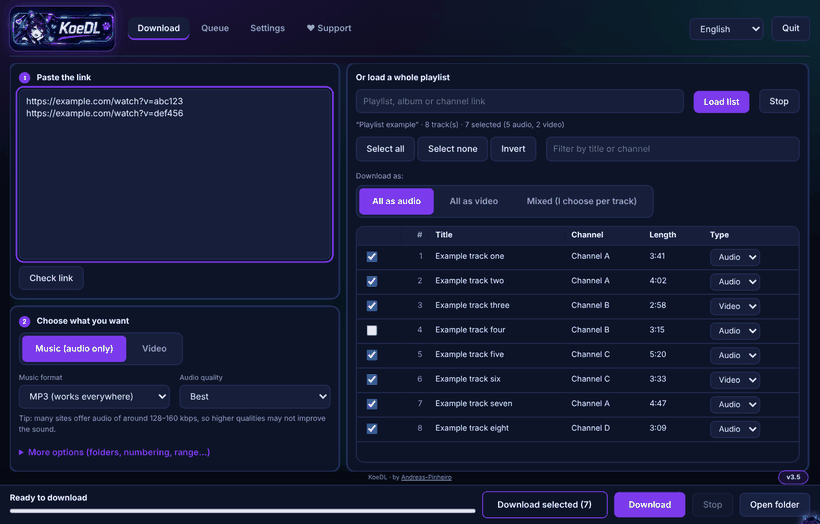
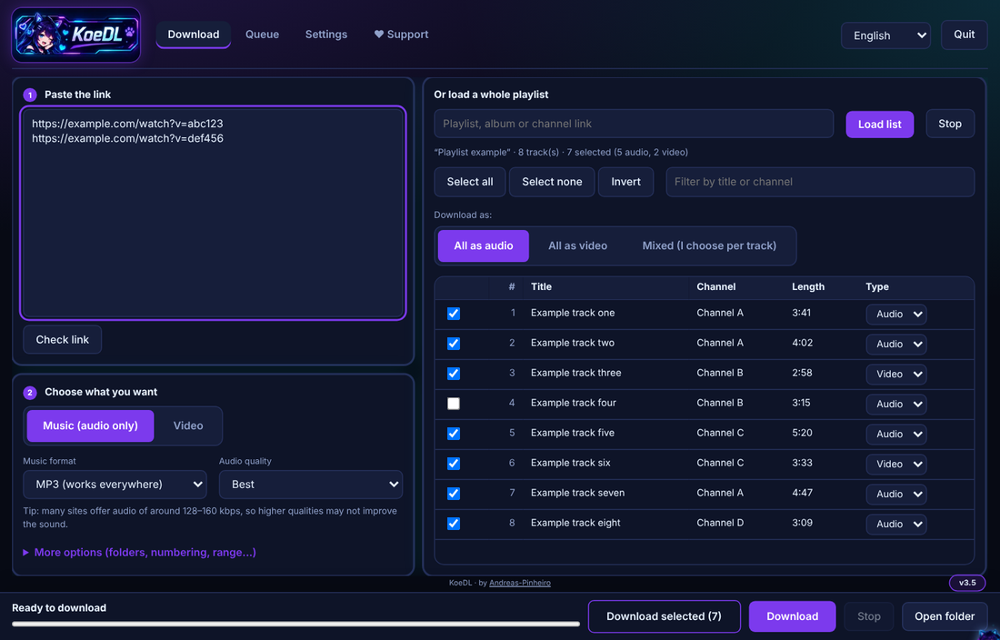
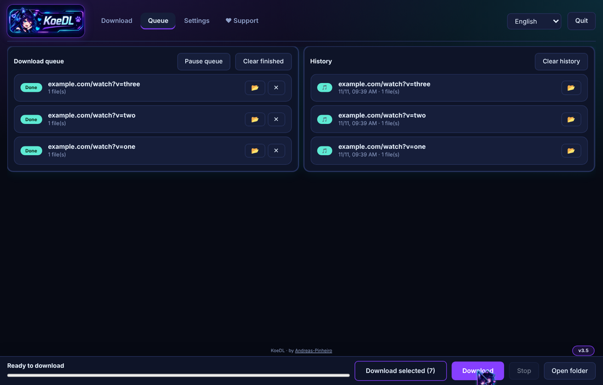
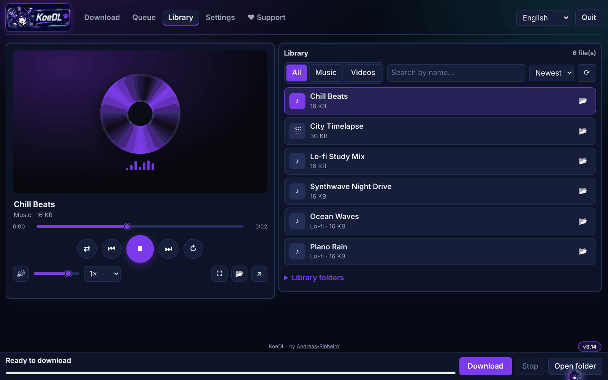
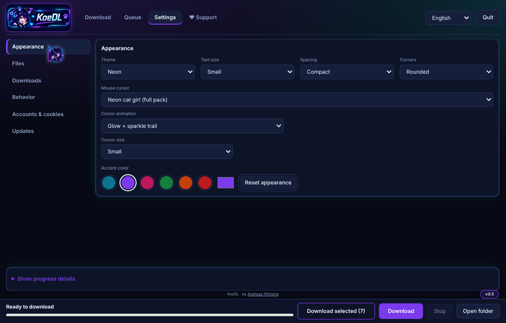
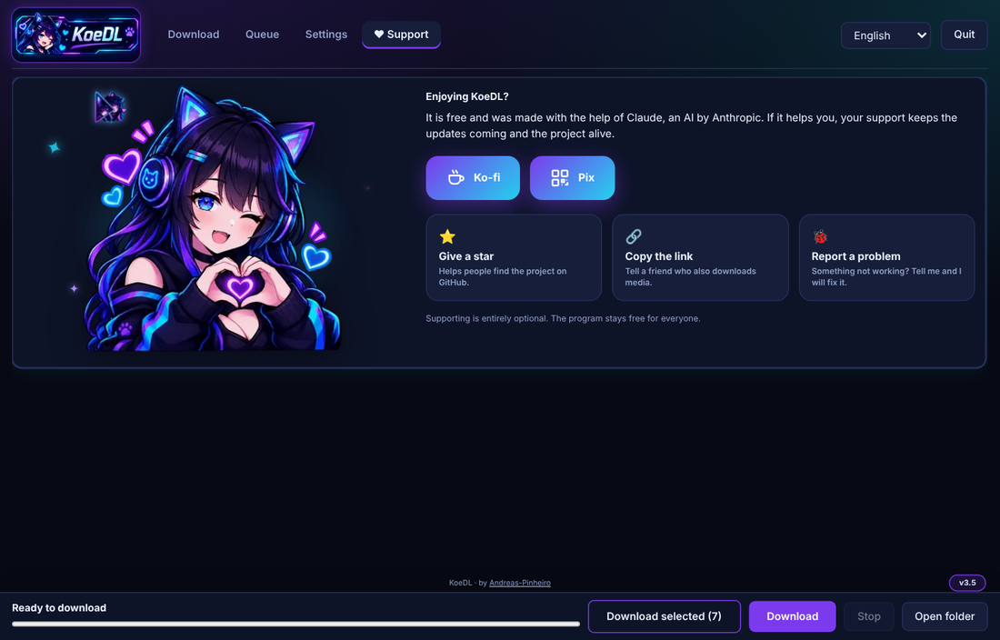

<p align="center"></p>

# KoeDL · Media-Downloader

Desktop application for Windows that downloads video and audio from any site supported by [yt-dlp](https://github.com/yt-dlp/yt-dlp). It serves a local web interface in its own window and does not require Python.

[Português](README.pt-BR.md)

> **Status:** developed and tested on Linux (PowerShell 7 backend with yt-dlp, interface in Chromium). Testing on Windows is limited: the `.exe` build, browser cookie reading, process termination and shortcut creation depend on Windows and may need adjustment. If something fails, open an issue with the error message.

## Screenshots

<p align="center"></p>

<p align="center">





</p>

## Features

- **Music or video** from any site supported by [yt-dlp](https://github.com/yt-dlp/yt-dlp); see its list of supported sites.
- **Audio:** MP3, M4A, Opus, FLAC or WAV, with quality selection and embedded cover art and metadata.
- **Video:** MP4 (H.264 + AAC) or MKV (stream copy, no conversion), with an optional resolution cap.
- **Playlists:** one folder named after the playlist (resuming where it stopped), a new folder per run (name + date and time), or no folder. Multiple links can be saved into a dated batch folder.
- **Playlist panel** beside the link box: paste links on the left and load a playlist on the right, select tracks and set audio or video per track. Optional Music / Videos subfolders.
- **Resume:** files already downloaded are skipped, with an option to start over.
- **Queue:** downloads run one after another, with pause, remove and retry; items can be added while a download is running.
- **Library and player:** lists downloaded files and plays audio and video inside the application (cover, progress bar, volume, speed, shuffle, repeat, fullscreen, search, filter, sort). Additional music and video folders can be added. Formats the built-in player cannot open can be sent to the Windows player.
- **Convert:** extracts audio from local video files using the bundled ffmpeg.
- **History:** every finished download is listed, with a button to show the file in its folder.
- **Settings:** speed limit and connections per file, separate music and video folders, and a Windows notification, program exit or shutdown when the queue finishes.
- **Link handling:** the copied link is pasted automatically on start, links can be dragged into the window, and keyboard shortcuts are available (Ctrl+Enter downloads, Ctrl+L focuses the link box, Ctrl+1..5 switch tabs).
- **Themes:** Neon (default), Midnight, Forest, Sakura, light and dark, plus accent colors.
- **Failed downloads:** an alternative version is searched for, and unresolved items are listed with the reason.
- **Cookies:** rotates between Firefox, Edge, Chrome, Brave, Opera and Vivaldi, and also accepts a `cookies.txt` file next to the program.
- **Updates:** yt-dlp is updated on every start (stable or nightly channel); ffmpeg and deno are checked periodically. A failed download caused by an outdated extractor is retried after the update. Dependency downloads retry with increasing waits and a fallback address.
- **Shortcuts:** Desktop and Start Menu shortcuts are created on the first run. Pinning to the taskbar is not automated by Windows; use right-click on the shortcut > *Pin to taskbar*.
- **Self-update:** the program checks this repository on start and installs newer versions of itself (`.bat` and `.exe` builds; can be disabled in Settings).
- **Language:** English and Portuguese, selected in the header and remembered.
- **`.exe` build:** opening the `.bat` attempts to build `KoeDL.exe` next to it, with an icon and tray menu. A Settings button creates the Desktop and Start Menu shortcuts.

## How to use

### Installer (recommended)

1. Open the [**Releases** page](https://github.com/Andreas-Pinheiro/KoeDL_Media_Downloader/releases/latest) and download **`KoeDL-Setup.exe`** from *Assets*.
2. Run it, choose **Install on this PC** or **Portable version**, and click **Install**.
3. Open **KoeDL** from the Desktop or Start Menu. On the first run it downloads yt-dlp, ffmpeg and deno (internet connection required).
4. Paste the links and click **Download**. Files are saved to your `Downloads\KoeDL` folder, which can be changed in Settings.

**SmartScreen or antivirus warning:** the executables are not digitally signed, so Windows may show a warning. Click **More info** > **Run anyway**, or verify the SHA-256 hash published with the release (see *Verify your download*).

### Single file, no installation

Download **`KoeDL.bat`** from the same Releases page, place it in a folder of your choice (for example `C:\KoeDL`) and run it. It behaves the same way and is an alternative when the `.exe` is blocked. The application opens in its own window (Microsoft Edge WebView2, downloaded automatically if missing); Edge or Chrome in app mode is only a fallback. The window remembers its size and position.

Files created next to the program (`.bat` version): `bin\` (helper programs, `settings.json`, download history in `archives\`), `Downloads\` and, if built, the `.exe`.

## Requirements

- Windows 10 or 11 (64-bit).
- Internet access on the first run (yt-dlp, ffmpeg and deno are downloaded from GitHub) and for downloading media.
- Microsoft Edge WebView2 Runtime (included in Windows 11 and recent Windows 10; the installer offers to download it if missing).
- No Python, no administrator rights (in the default folder) and no other installation.

## Updating and uninstalling

- **Updating:** the program checks the latest GitHub release on start and shows an **Update now** banner. It can also be checked under **Settings > Updates**. Before accepting an update, the download is compared with the SHA-256 hash published in the same release; if the hashes differ, the update is ignored.
- **Installer:** download the newest `KoeDL-Setup.exe` and click **Update**. Your settings, history and queue are kept; no uninstallation is required first.
- **Uninstalling:** *Windows Settings > Apps > KoeDL > Uninstall*. Downloads are not deleted. The portable version has no uninstaller; delete its folder.
- **Manual update:** download the newest `KoeDL-Setup.exe` (or `KoeDL.bat`) from Releases.

## Verify your download

Each release includes a `SHA256SUMS.txt` with the SHA-256 hash of every file (`KoeDL-Setup.exe`, `KoeDL.exe`, `KoeDL.bat`). To check a file in PowerShell:

```powershell
Get-FileHash .\KoeDL-Setup.exe -Algorithm SHA256
```

The result must match the published hash.

## FAQ

**Does it work offline?** Only for playing files already downloaded. Downloading and updating require internet access.

**Is it safe? My antivirus or Windows reported a problem.** The executables are built by GitHub Actions from the source in this repository and are not digitally signed, so SmartScreen and some antivirus engines may report them as suspicious. Compare the SHA-256 hash with `SHA256SUMS.txt`; if the warning persists, use `KoeDL.bat`, whose code is readable. The source is public and can be audited.

**Where are the files saved?** To the `Downloads` folder next to the program (installed version: `Downloads\KoeDL` in your user folder). This can be changed in Settings, including separate folders for music and video.

**A video failed to download.** Click **Settings > Update everything** and try again. If it keeps failing, open an issue with the link and `bin\app.log`.

**Can it be used on several PCs?** Yes, with the portable version on a USB drive.

**Does KoeDL collect any data?** No. See [SECURITY.md](SECURITY.md).

**Can the interface layout be changed?** Yes. **Settings > Interface** switches between the Classic and Neon layouts; the choice is saved and the page reloads.

## Installer

`KoeDL-Setup.exe` (from the Releases page) offers:

- **Install on this PC** (shortcuts, Windows Apps entry, uninstaller) or the **Portable version** (only copies the files; nothing is registered in Windows).
- **Install location:** the default folder, or another one chosen with *Browse*.
- **Updating:** an existing installation is detected and replaced, keeping settings, history and queue.

> **Administrator:** the default folder (inside your user profile) does not require administrator rights. A protected folder such as `C:\Program Files` requires **right-click `KoeDL-Setup.exe` > Run as administrator**; the installer warns about this and offers to reopen with elevated rights.

## Building from source

The single-file `KoeDL.bat` is generated from the sources in `src/` (backend, interface, translations, C#). To rebuild it:

```
python build/build.py          # rewrites KoeDL.bat and Media-Downloader.bat
python build/build.py --check  # fails if the committed .bat does not match src/
```

Pushing a tag (for example `v3.16.0`) triggers GitHub Actions (`.github/workflows/build.yml`), which builds `KoeDL.bat`, `KoeDL.exe` and `KoeDL-Setup.exe`, generates `SHA256SUMS.txt` and publishes them on the release, using the matching section of `CHANGELOG.md` as the release notes.

## Technologies

| Piece | Purpose |
|---|---|
| **Batch (`.bat`) + PowerShell 5.1** | Single file: the `.bat` reads itself and runs the PowerShell part without depending on the script execution policy |
| **PowerShell `HttpListener`** | Local web server (`127.0.0.1` only, ports 8765-8789) with a per-run token and `Host` header check |
| **PowerShell runspaces** | Downloads, playlist loading and updates in the background without blocking the interface |
| **Plain HTML + CSS + JavaScript** | Interface embedded in the file, automatic light/dark theme, English and Portuguese |
| **[yt-dlp](https://github.com/yt-dlp/yt-dlp)** | Extraction and download |
| **[FFmpeg](https://ffmpeg.org/)** (yt-dlp builds) | Conversion, audio/video merging, embedded cover art |
| **[Deno](https://deno.com/)** | Runs the JavaScript required by some sites |
| **C# 5 + `CSharpCodeProvider` (.NET Framework)** | Compiles the `.exe` launcher with a tray icon on the user's machine |
| **WScript.Shell** | Shortcut creation |

## How it works inside

- The `.bat` extracts the text after the `###PS###` marker and runs it as a script block.
- Each yt-dlp run uses a temporary UTF-8 config file, avoiding quoting and accent issues on the Windows command line.
- Progress comes from `--progress-template`; finished files from `--exec`.
- The playlist folder name is resolved before the download, because yt-dlp replaces `/` inside template fields.
- The history (`--download-archive`) is kept per link and per format/quality.
- The local API (`/api/...`) is token-protected, leaving room for a browser extension or a standalone app in the future.

## Legal notice

Use this software only to download content you have the right to download (your own, public domain, licensed, or otherwise authorized). Downloading some content may violate a site's terms of service or copyright law in your country. Responsibility for use lies with the user. This project is not affiliated with YouTube, Google or any other site mentioned.

## License

[MIT](LICENSE). yt-dlp, FFmpeg and Deno have their own licenses.

## Credits

The download, conversion and JavaScript runtime work is done by [yt-dlp](https://github.com/yt-dlp/yt-dlp), [FFmpeg](https://ffmpeg.org/) and [Deno](https://deno.com/), each under its own license. This project only orchestrates them.

---

Maintained by **[Andreas-Pinheiro](https://github.com/Andreas-Pinheiro)**.
