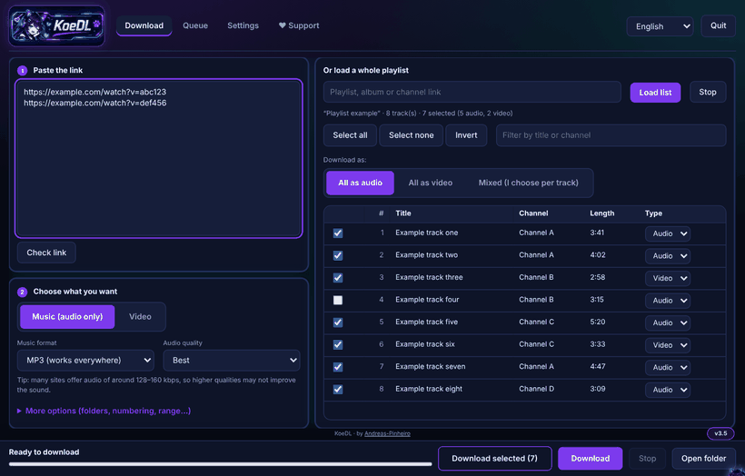
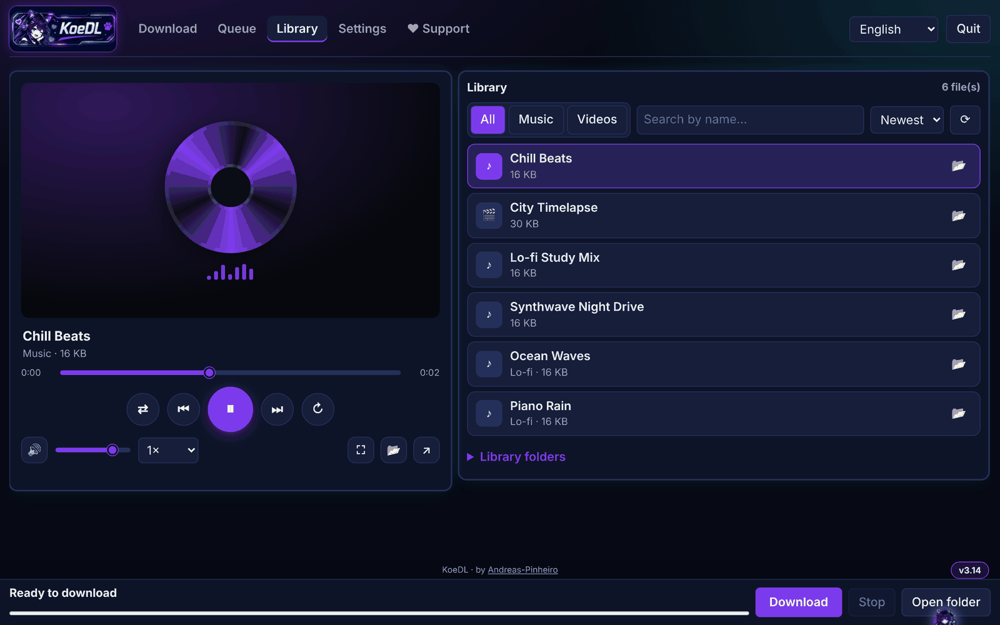

<p align="center"></p>

# KoeDL · Media-Downloader

**Free video and audio downloader for Windows (yt-dlp) - just download the installer and open it.**

<sub>Keywords: video downloader, audio downloader, MP3 downloader, playlist downloader, yt-dlp GUI, Windows, WebView2.</sub>


**by Andreas-Pinheiro** · [Português](README.pt-BR.md)

Audio and **video downloader** for Windows. Download the installer (`KoeDL-Setup.exe`) from the [Releases](https://github.com/Andreas-Pinheiro/KoeDL_Media_Downloader/releases/latest) page and you are done; there is also a single-file version (`KoeDL.bat`). It opens a local web interface, works with over a thousand sites, and keeps playlists organized in folders.

> **Status:** built and tested on Linux (backend on PowerShell 7 with the real yt-dlp, interface in Chromium). Tested by the author on Windows only lightly: the `.exe` build, browser cookie reading, process termination and shortcuts depend on Windows and may need adjustments. If something fails, open an *issue* with the error message.

## Screenshots

<p align="center"></p>

<p align="center">





</p>

## Features

- **Music or video** from any site supported by [yt-dlp](https://github.com/yt-dlp/yt-dlp) (over a thousand; see its list of supported sites).
- **Audio:** MP3, M4A, Opus, FLAC or WAV, with quality choice and embedded cover art/metadata.
- **Video:** MP4 (H.264 + AAC, plays everywhere) or MKV (original, no conversion), with an optional resolution cap.
- **Organized playlists:** one folder named after the playlist (resumes where it stopped), a new folder every time (name + date and time), or no folder. When you paste several links, everything can go into a "Batch date-time" folder.
- **Playlist next to your links:** on the same tab you can paste links on the left and load a whole playlist on the right, tick the tracks and choose audio or video per track (all audio, all video, or mixed). Optional Music / Videos subfolders.
- **Resume:** remembers what was already downloaded and skips repeats. There is an option to start over.
- **Queue:** everything you add goes into a queue and runs one after the other; pause, remove or retry items. Add more while it is downloading.
- **Library / player:** a tab that lists everything you downloaded and plays music and video inside KoeDL, with an animated cover, progress bar, volume, speed, shuffle, repeat, fullscreen, search, filter and sort. You can also **add your own music and video folders** (files not downloaded by KoeDL). Formats the built-in player cannot open can be sent to the Windows player or shown in their folder.
- **History:** every finished download is listed, with a button to show the file in its folder.
- **Speed limit and connections** per file, separate folders for music and videos, and a Windows notification (or close the program / shut down the PC) when the queue finishes.
- **Handy extras:** the copied link is pasted by itself when you open the program, you can drag links into the window, and there are keyboard shortcuts (Ctrl+Enter downloads, Ctrl+L focuses the link box, Ctrl+1..5 switch tabs).
- **Themes:** Neon, Midnight, Forest, Sakura, light, dark, plus accent colors and a custom cat-girl cursor.
- **Blocked or removed videos:** looks for an alternative version and lists what could not be solved, with the reason.
- **Cookies:** rotates between Firefox, Edge, Chrome, Brave, Opera and Vivaldi when one fails or gets blocked. Also accepts a `cookies.txt` next to the program.
- **Always up to date:** yt-dlp is updated every time the program opens (stable or nightly channel). ffmpeg and deno are checked now and then. If a download fails because of an outdated extractor, it updates and retries on its own. Dependency downloads retry with increasing waits and fall back to an alternative address.
- **Shortcuts on the first run:** creates Desktop and Start Menu shortcuts by itself (once) and points them to the `.exe` as soon as it is built. Taskbar pinning cannot be automated by Windows: right-click the shortcut > *Pin to taskbar*.
- **Self-updating:** besides yt-dlp/ffmpeg/deno, the program checks this repository when it opens and downloads newer versions of itself (works with the `.bat` and the `.exe`; can be turned off in Settings).
- **Language:** opens in English; switch to Portuguese with the selector at the top. Your choice is remembered.
- **Builds an `.exe`:** when you open the `.bat`, it tries to create `KoeDL.exe` next to it, with an icon and tray menu. A button in Settings creates Desktop and Start Menu shortcuts.

## How to use

### Easiest way (recommended): the installer

1. Go to the [**Releases** page](https://github.com/Andreas-Pinheiro/KoeDL_Media_Downloader/releases/latest) and download **`KoeDL-Setup.exe`** (under *Assets*).
2. Double-click it. Choose **Install on this PC** (recommended) or **Portable version**, and click **Install**. Nothing else to configure.
3. Open **KoeDL** from the Desktop or Start Menu. The first time it downloads yt-dlp, ffmpeg and deno by itself (needs internet).
4. Paste the links and click **Download**. Files go to your `Downloads\KoeDL` folder (changeable in Settings).

**Windows shows a blue "Windows protected your PC" screen?** That is normal for free programs that are not digitally signed. Click **More info**, then **Run anyway**. The file is built automatically by GitHub from the source code in this repository, and its SHA-256 is published next to it (see *Verify your download* below).

### Alternative: a single file, no install

Download **`KoeDL.bat`** from the same Releases page, put it in a folder of your own (for example `C:\KoeDL`) and double-click it. It does the same thing and is handy if your antivirus complains about the `.exe`. The app opens in its own window (Microsoft Edge WebView2, downloaded automatically if missing); Edge/Chrome in app mode is only a fallback. The window remembers its size and position.

Files created next to the program (`.bat` version): `bin\` (helper programs, `settings.json`, download history in `archives\`), `Downloads\` and, if built, the `.exe`.

## Requirements

- Windows 10 or 11 (64-bit).
- Internet access on the first run (downloads yt-dlp, ffmpeg and deno from GitHub) and to download media.
- Microsoft Edge WebView2 Runtime (comes with Windows 11 and recent Windows 10; the installer offers to download it if missing).
- No Python, no administrator rights (in the default folder) and nothing else to install.

## Updating and uninstalling

- **Updating:** the program checks the latest GitHub release when it opens and shows an **Update now** banner. You can also click **Settings > Updates > Check for program updates**. Before accepting an update it checks the file against the SHA-256 hash published in the same release; if they do not match, the update is ignored.
- **Installer:** if KoeDL is already installed, download the newest `KoeDL-Setup.exe` and click **Update**: it replaces the old version and keeps your settings, history and queue. No need to uninstall first.
- **Uninstalling:** *Windows Settings > Apps > KoeDL > Uninstall*. Your downloads are not deleted. The portable version has no uninstaller: just delete its folder.
- **Manual update:** download the newest `KoeDL-Setup.exe` (or `KoeDL.bat`) from Releases.

## Verify your download

Each release includes a `SHA256SUMS.txt` with the SHA-256 hash of every file (`KoeDL-Setup.exe`, `KoeDL.exe`, `KoeDL.bat`). To check a file in PowerShell:

```powershell
Get-FileHash .\KoeDL-Setup.exe -Algorithm SHA256
```

The result must be identical to the one published.

## FAQ

**Does it work offline?** Only to play what you already downloaded. Downloading and updating need internet.

**Is it safe? My antivirus or Windows warned me.** It may show a **false positive**. The `.exe` files are built automatically by GitHub from the source in this repository and are not digitally signed (a certificate costs money), so Windows SmartScreen and a few antivirus engines may warn about them. On VirusTotal, only a handful of engines (generic machine-learning/heuristic detections, no named malware) flag the `.exe`, because the app downloads files, runs PowerShell and compiles a small helper, which looks suspicious to heuristics. `KoeDL.bat` gets a much better result (1 of 61 engines), and its code is readable. Check the SHA-256 against `SHA256SUMS.txt`; if it still bothers you, use `KoeDL.bat`, which does the same thing. The code is public, so you can audit it, and you can report the false positive to your antivirus vendor.

**Where do the files go?** To the `Downloads` folder next to the program (installed version: `Downloads\KoeDL` in your user folder). You can change it in Settings, including separate folders for music and video.

**A video failed to download.** Click **Settings > Update everything** and try again. If it keeps failing, open an issue with the link and `bin\app.log`.

**Can I use it on several PCs?** Yes: use the portable version on a USB stick.

**Does KoeDL collect any data?** No. See [SECURITY.md](SECURITY.md).

## Installer

`KoeDL-Setup.exe` (from the Releases page) lets you choose:

- **Install on this PC** (shortcuts, Windows Apps entry, uninstall) or the **Portable version** (only copies the files to a folder; nothing is registered in Windows, great for a USB stick).
- **Where to put it**: use the default folder or click *Browse*.
- **Updating**: if KoeDL is already installed, the installer detects it and **replaces it** (your settings, history and queue are kept). No need to uninstall first.

> ⚠️ **Administrator:** the default folder (inside your user profile) does **not** need administrator rights. If you choose a protected folder (like `C:\Program Files`), you must **right-click `KoeDL-Setup.exe` > Run as administrator**. The installer also warns you and offers to reopen as administrator.

## Building from source

The single-file `KoeDL.bat` is generated from readable sources in `src/` (backend, interface, translations, C#). To rebuild it:

```
python build/build.py          # rewrites KoeDL.bat and Media-Downloader.bat
python build/build.py --check  # fails if the committed .bat does not match src/
```

Pushing a tag such as `v3.11` makes GitHub Actions (`.github/workflows/build.yml`) build `KoeDL.bat`, `KoeDL.exe` and `KoeDL-Setup.exe`, generate `SHA256SUMS.txt` and publish everything on the release, using the matching section of `CHANGELOG.md` as the release notes.

## Technologies

| Piece | Purpose |
|---|---|
| **Batch (`.bat`) + PowerShell 5.1** | Single file: the `.bat` reads itself and runs the PowerShell part without depending on the script execution policy |
| **PowerShell `HttpListener`** | Local web server (`127.0.0.1` only, ports 8765-8789) with a per-run token and `Host` header check |
| **PowerShell runspaces** | Download, playlist loading and updates in the background without freezing the interface |
| **Plain HTML + CSS + JavaScript** | Interface embedded in the file itself, automatic light/dark theme, English/Portuguese |
| **[yt-dlp](https://github.com/yt-dlp/yt-dlp)** | Extraction and download |
| **[FFmpeg](https://ffmpeg.org/)** (yt-dlp builds) | Conversion, merging audio and video, embedded cover art |
| **[Deno](https://deno.com/)** | Runs the JavaScript some sites require today |
| **C# 5 + `CSharpCodeProvider` (.NET Framework)** | Compiles the `.exe` launcher with a tray icon, right on the user's machine |
| **WScript.Shell** | Shortcut creation |

## How it works inside

- The `.bat` extracts the text after the `###PS###` marker and runs it as a script block.
- Each yt-dlp run uses a temporary UTF-8 config file, avoiding quoting and accent problems on the Windows command line.
- Progress comes from `--progress-template`; finished files from `--exec`.
- The playlist folder name is resolved before the download, because yt-dlp replaces `/` inside template fields.
- The history (`--download-archive`) is kept per link and per format/quality.
- The local API (`/api/...`) is simple and token-protected, leaving room for a browser extension or a standalone app in the future.

## Legal notice

Use it only to download content you have the right to download (yours, public domain, licensed, or authorized). Downloading some content may violate site terms of service or copyright laws in your country. The responsibility for use lies with the user. This project is not affiliated with YouTube, Google or any other site mentioned.

## License

[MIT](LICENSE). yt-dlp, FFmpeg and Deno have their own licenses.

## Credits

All the heavy lifting is done by [yt-dlp](https://github.com/yt-dlp/yt-dlp), [FFmpeg](https://ffmpeg.org/) and [Deno](https://deno.com/), which have their own licenses. This project only orchestrates them.

---

Made by **[Andreas-Pinheiro](https://github.com/Andreas-Pinheiro)**.

## Support the project

<p align="center"></p>

KoeDL is free and was built with the help of Claude, an AI by Anthropic. If it helps you, you can support it for free:

- ⭐ **Give the repository a star** at the top of this page.
- 🔗 **Share it** with a friend who also downloads media.
- ☕ **Buy me a coffee** on [Ko-fi](https://ko-fi.com/andreaspinheiro001).
- 🐞 **Report a problem** in the [Issues](https://github.com/Andreas-Pinheiro/KoeDL_Media_Downloader/issues) tab.

The same options (and the coffee button) are inside the app, in the **♥ Support** tab. Supporting is entirely optional.
