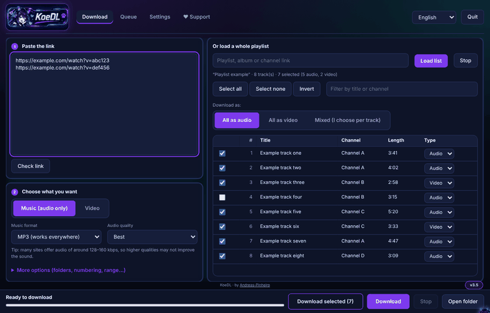
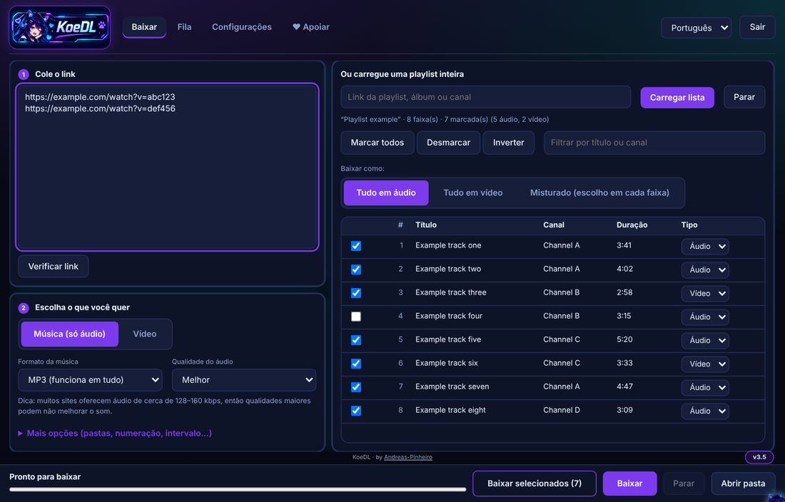
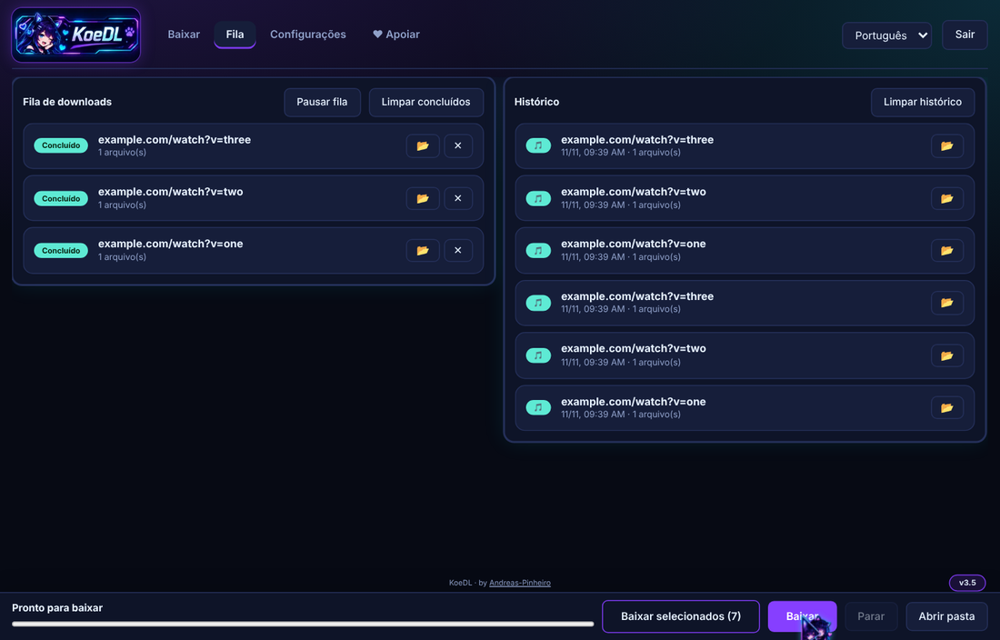
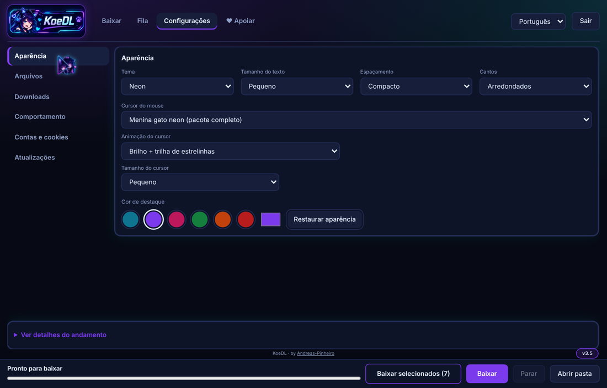
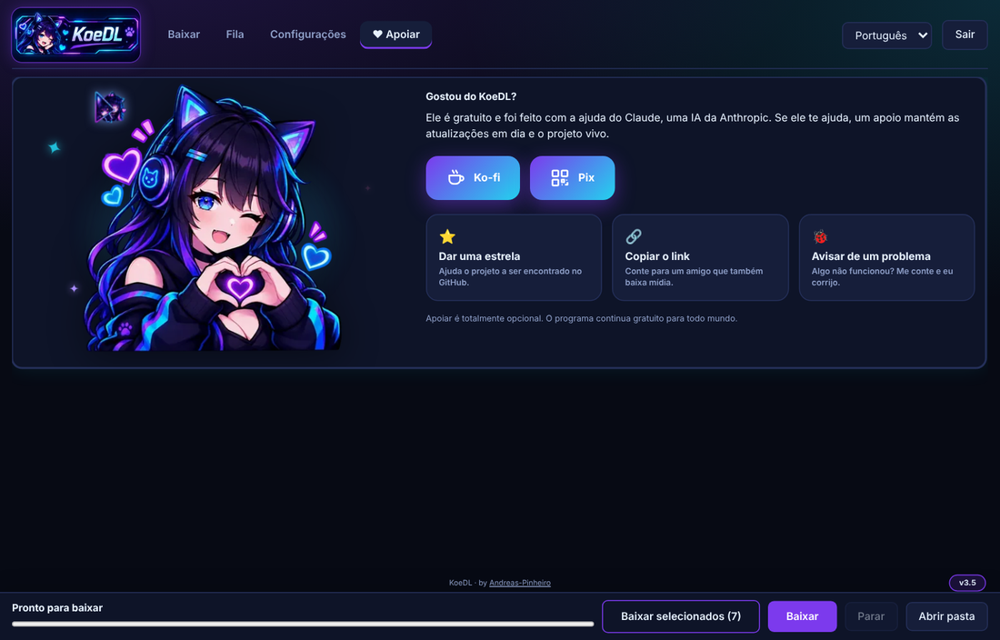

<p align="center"></p>

# KoeDL · Media-Downloader

**Baixador de vídeo e áudio grátis para Windows (yt-dlp) - é só baixar o instalador e abrir.**

<sub>Palavras-chave: baixar vídeo, baixar música, baixar MP3, baixar playlist, interface para yt-dlp, Windows, WebView2.</sub>


**by Andreas-Pinheiro** · [English](README.md)

Baixador de **áudio e vídeo** para Windows, Baixe o instalador (`KoeDL-Setup.exe`) na página de [Releases](https://github.com/Andreas-Pinheiro/KoeDL_Media_Downloader/releases/latest) e pronto; também existe uma versão de arquivo único (`KoeDL.bat`). Abre uma interface em janela própria, funciona com mais de mil sites e organiza as playlists em pastas.

> **Status:** desenvolvido e testado em ambiente Linux (backend em PowerShell 7 com o yt-dlp real e interface no Chromium). **Ainda não foi testado no Windows.** A geração do `.exe`, a leitura de cookies dos navegadores, o encerramento de processos e a criação de atalhos dependem do Windows e podem precisar de ajustes. Se algo falhar, abra uma *issue* com a mensagem de erro.

## Capturas de tela

<p align="center"></p>

<p align="center">




</p>

## O que faz

- **Música ou vídeo** de qualquer site suportado pelo [yt-dlp](https://github.com/yt-dlp/yt-dlp) (mais de mil; veja a lista de sites dele).
- **Áudio:** MP3, M4A, Opus, FLAC ou WAV, com escolha de qualidade e capa/metadados embutidos.
- **Vídeo:** MP4 (H.264 + AAC, compatível com tudo) ou MKV (original, sem converter), com limite de resolução opcional.
- **Playlists organizadas:** uma pasta com o nome da playlist (retoma de onde parou), uma pasta nova a cada vez (nome + data e hora) ou sem pasta. Ao colar vários links, pode guardar tudo numa pasta "Lote data-hora".
- **Playlist ao lado dos links:** na mesma aba você cola links à esquerda e carrega uma playlist inteira à direita, marca as faixas e escolhe áudio ou vídeo em cada uma (tudo áudio, tudo vídeo ou misturado). Opção de subpastas Músicas / Vídeos.
- **Retomada:** registra o que já foi baixado e pula repetidos. Há opção de recomeçar do zero.
- **Fila:** tudo que você adiciona entra numa fila e roda um depois do outro; dá para pausar, remover ou tentar de novo. Pode adicionar mais enquanto baixa.
- **Biblioteca:** uma aba que lista tudo o que você baixou (música e vídeo) e toca dentro do KoeDL, com busca, filtro, anterior/próxima, aleatório e "tocar a próxima". Formatos que o player embutido não abre podem ser mostrados na pasta.
- **Histórico:** cada download concluído fica numa lista, com botão para mostrar o arquivo na pasta.
- **Limite de velocidade e conexões** por arquivo, pastas separadas para músicas e vídeos, e aviso do Windows (ou fechar o programa / desligar o PC) quando a fila terminar.
- **Extras:** o link copiado é colado sozinho ao abrir o programa, dá para arrastar links para a janela e há atalhos (Ctrl+Enter baixa, Ctrl+L vai para o campo do link, Ctrl+1..5 trocam de aba).
- **Temas:** Neon, Meia-noite, Floresta, Sakura, claro, escuro, cores de destaque e cursor da menina gato.
- **Vídeos bloqueados ou removidos:** procura uma versão alternativa e lista o que não teve solução, com o motivo.
- **Cookies:** rodízio entre Firefox, Edge, Chrome, Brave, Opera e Vivaldi quando um falha ou é bloqueado. Também aceita um `cookies.txt` ao lado do programa.
- **Sempre atualizado:** o yt-dlp é atualizado toda vez que abre (canal estável ou nightly). O ffmpeg e o deno são verificados de tempos em tempos. Se um download falhar por extrator desatualizado, atualiza e tenta de novo sozinho.
- **Atalhos na primeira abertura:** cria sozinho os atalhos da Área de Trabalho e do Menu Iniciar (uma vez) e os aponta para o `.exe` assim que ele é gerado. O Windows não permite fixar na barra de tarefas por programa: clique com o botão direito no atalho > *Fixar na barra de tarefas*.
- **Atualiza a si mesmo:** além do yt-dlp/ffmpeg/deno, o programa consulta este repositório ao abrir e baixa versões novas dele mesmo (vale para o `.bat` e para o `.exe`; dá para desligar em Configurações).
- **Idioma:** abre em inglês; troque para Português no seletor no topo da página. A escolha fica salva para a próxima vez.
- **Gera um `.exe`:** ao abrir o `.bat`, tenta criar `KoeDL.exe` ao lado, com ícone e menu na bandeja do sistema. Também cria atalhos na Área de Trabalho e no Menu Iniciar (botão na aba Configurações).

## Como usar

### Jeito mais fácil (recomendado): o instalador

1. Abra a página de [**Releases**](https://github.com/Andreas-Pinheiro/KoeDL_Media_Downloader/releases/latest) e baixe o **`KoeDL-Setup.exe`** (em *Assets*).
2. Dê duplo clique. Escolha **Instalar no computador** (recomendado) ou **Versão portátil** e clique em **Instalar**. Não precisa configurar mais nada.
3. Abra o **KoeDL** pela Área de Trabalho ou pelo Menu Iniciar. Na primeira vez ele baixa sozinho o yt-dlp, o ffmpeg e o deno (precisa de internet).
4. Cole os links e clique em **Baixar**. Os arquivos ficam na pasta `Downloads\KoeDL` (dá para trocar em Configurações).

**Apareceu uma tela azul "O Windows protegeu o computador"?** É normal em programas gratuitos que não têm assinatura digital. Clique em **Mais informações** e depois em **Executar assim mesmo**. O arquivo é gerado automaticamente pelo GitHub a partir do código deste repositório, e o SHA-256 dele fica publicado ao lado (veja *Conferir o arquivo baixado* abaixo).

### Alternativa: um arquivo só, sem instalar

Baixe o **`KoeDL.bat`** na mesma página de Releases, coloque numa pasta sua (por exemplo `C:\KoeDL`) e dê duplo clique. Faz a mesma coisa e ajuda se o antivírus reclamar do `.exe`. O app abre em janela própria (Microsoft Edge WebView2, baixado automaticamente se faltar); Edge/Chrome em modo app é só alternativa. A janela lembra tamanho e posição.

Arquivos criados ao lado do programa (versão `.bat`): `bin\` (programas auxiliares, `settings.json`, histórico de downloads em `archives\`), `Downloads\` e, se gerado, o `.exe`.

## Requisitos

- Windows 10 ou 11 (64 bits).
- Internet na primeira execução (baixa yt-dlp, ffmpeg e deno do GitHub) e para baixar as mídias.
- Microsoft Edge WebView2 Runtime (já vem no Windows 11 e no Windows 10 atualizado; o instalador oferece baixar se faltar).
- Não precisa de Python, nem de administrador (na pasta padrão), nem de mais nada.

## Atualizar e desinstalar

- **Atualizar:** o programa verifica a última release do GitHub ao abrir e mostra o aviso **Atualizar agora**. Também dá para clicar em **Configurações > Atualizações > Verificar atualizações do programa**. Antes de aceitar uma atualização, ele confere o arquivo com o hash SHA-256 publicado na mesma release; se não bater, a atualização é ignorada.
- **Instalador:** se o KoeDL já estiver instalado, baixe o `KoeDL-Setup.exe` mais novo e clique em **Atualizar**: ele substitui a versão antiga e mantém suas configurações, histórico e fila. Não precisa desinstalar antes.
- **Desinstalar:** *Configurações do Windows > Aplicativos > KoeDL > Desinstalar*. Seus downloads não são apagados. A versão portátil não tem desinstalador: é só apagar a pasta.
- **Atualização manual:** baixe o `KoeDL-Setup.exe` (ou o `KoeDL.bat`) mais novo na página de Releases.

## Conferir o arquivo baixado

Cada release traz um `SHA256SUMS.txt` com o hash SHA-256 de cada arquivo (`KoeDL-Setup.exe`, `KoeDL.exe`, `KoeDL.bat`). Para conferir no PowerShell:

```powershell
Get-FileHash .\KoeDL-Setup.exe -Algorithm SHA256
```

O resultado deve ser idêntico ao publicado.

## Perguntas frequentes

**Funciona sem internet?** Só para tocar o que você já baixou. Baixar e atualizar precisam de internet.

**É seguro? Meu antivírus ou o Windows avisou.** Os `.exe` são gerados automaticamente pelo GitHub a partir do código deste repositório e não têm assinatura digital (o certificado é pago), então o Windows SmartScreen e alguns antivírus podem avisar. Confira o SHA-256 no `SHA256SUMS.txt`. Se ainda assim incomodar, use o `KoeDL.bat`, que faz a mesma coisa e cujo código dá para ler.

**Para onde vão os arquivos?** Para a pasta `Downloads` ao lado do programa (versão instalada: `Downloads\KoeDL` no seu usuário). Dá para mudar em Configurações, inclusive pastas separadas para música e vídeo.

**Um vídeo não baixou.** Clique em **Configurações > Atualizar tudo** e tente de novo. Se continuar, abra uma issue com o link e o `bin\app.log`.

**Dá para usar em vários PCs?** Dá: use a versão portátil em um pendrive.

**O KoeDL coleta algum dado?** Não. Veja o [SECURITY.md](SECURITY.md).

## Instalador

O `KoeDL-Setup.exe` (da página de Releases) permite escolher:

- **Instalar no computador** (atalhos, entrada em Aplicativos do Windows, desinstalação) ou a **versão portátil** (só copia os arquivos para uma pasta; nada é registrado no Windows, ótima para pendrive).
- **Onde colocar**: use a pasta padrão ou clique em *Procurar*.
- **Atualizar**: se o KoeDL já estiver instalado, o instalador detecta e **substitui** (suas configurações, histórico e fila são mantidos). Não precisa desinstalar antes.

> ⚠️ **Administrador:** a pasta padrão (dentro do seu usuário) **não** precisa de administrador. Se escolher uma pasta protegida (como `C:\Arquivos de Programas`), é preciso **clicar com o botão direito no `KoeDL-Setup.exe` > Executar como administrador**. O instalador também avisa e oferece reabrir como administrador.

## Gerar a partir do código

O `KoeDL.bat` de arquivo único é gerado a partir de fontes legíveis em `src/` (backend, interface, traduções, C#). Para refazer:

```
python build/build.py          # reescreve KoeDL.bat e Media-Downloader.bat
python build/build.py --check  # falha se o .bat commitado não bate com src/
```

Ao criar uma tag como `v3.11`, o GitHub Actions (`.github/workflows/build.yml`) gera `KoeDL.bat`, `KoeDL.exe` e `KoeDL-Setup.exe`, cria o `SHA256SUMS.txt` e publica tudo na release, usando a seção correspondente do `CHANGELOG.md` como notas.

## Tecnologias usadas

| Peça | Para quê |
|---|---|
| **Batch (`.bat`) + PowerShell 5.1** | Arquivo único: o `.bat` lê a si mesmo e executa a parte em PowerShell sem depender da política de execução de scripts |
| **PowerShell `HttpListener`** | Servidor web local (somente `127.0.0.1`, portas 8765–8789) com token por execução e verificação do cabeçalho `Host` |
| **Runspaces do PowerShell** | Download, leitura de playlist e atualização em segundo plano, sem travar a interface |
| **HTML + CSS + JavaScript puros** | Interface embutida no próprio arquivo, com tema claro e escuro automático |
| **[yt-dlp](https://github.com/yt-dlp/yt-dlp)** | Extração e download |
| **[FFmpeg](https://ffmpeg.org/)** (builds do yt-dlp) | Conversão, junção de áudio e vídeo e capa embutida |
| **[Deno](https://deno.com/)** | Execução do JavaScript que alguns sites exigem hoje |
| **C# 5 + `CSharpCodeProvider` (.NET Framework)** | Compila o lançador `.exe` com ícone na bandeja, direto da máquina do usuário |
| **WScript.Shell** | Criação de atalhos |

## Como funciona por dentro

- O `.bat` extrai o texto depois do marcador `###PS###` e o executa como bloco de script.
- Cada execução do yt-dlp usa um arquivo de configuração temporário em UTF-8. Isso evita problemas de aspas e de acentos na linha de comando do Windows.
- O progresso vem de `--progress-template`; os arquivos concluídos, de `--exec`.
- O nome da pasta da playlist é resolvido antes do download. O yt-dlp troca `/` por outro caractere dentro de campos do modelo de nome, então a pasta não pode ser montada só por ele.
- O histórico (`--download-archive`) é separado por link e por formato/qualidade.
- A API local (`/api/...`) é simples e protegida por token, o que deixa espaço para uma extensão de navegador ou um app com janela própria no futuro.

## Aviso legal

Use apenas para baixar conteúdo que você tem o direito de baixar (seu, de domínio público, com licença que permita ou com autorização). Baixar certos conteúdos pode violar os termos de serviço dos sites ou leis de direitos autorais do seu país. A responsabilidade pelo uso é de quem usa. Este projeto não tem ligação com YouTube, Google ou qualquer outro site citado.

## Licença

[MIT](LICENSE). yt-dlp, FFmpeg e Deno têm licenças próprias.

## Créditos

Todo o trabalho pesado é do [yt-dlp](https://github.com/yt-dlp/yt-dlp), do [FFmpeg](https://ffmpeg.org/) e do [Deno](https://deno.com/), que têm suas próprias licenças. Este projeto só os orquestra.

---

Feito por **[Andreas-Pinheiro](https://github.com/Andreas-Pinheiro)**.

## Apoie o projeto

<p align="center"></p>

O KoeDL é gratuito e foi feito com a ajuda do Claude, uma IA da Anthropic. Se ele te ajuda, você pode apoiar de graça:

- ⭐ **Dê uma estrela** no repositório, no topo desta página.
- 🔗 **Compartilhe** com um amigo que também baixa mídia.
- ☕ **Pague um café** no [Ko-fi](https://ko-fi.com/andreaspinheiro001).
- 🐞 **Avise de um problema** na aba [Issues](https://github.com/Andreas-Pinheiro/KoeDL_Media_Downloader/issues).

As mesmas opções (e o botão de café) estão dentro do app, na aba **♥ Apoiar**. Apoiar é totalmente opcional.
