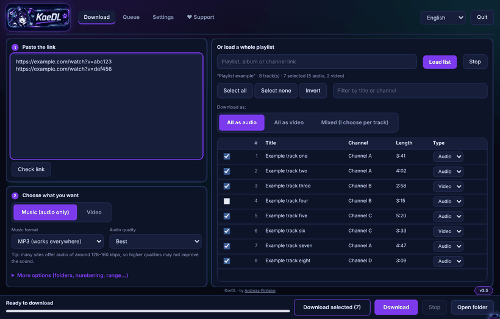
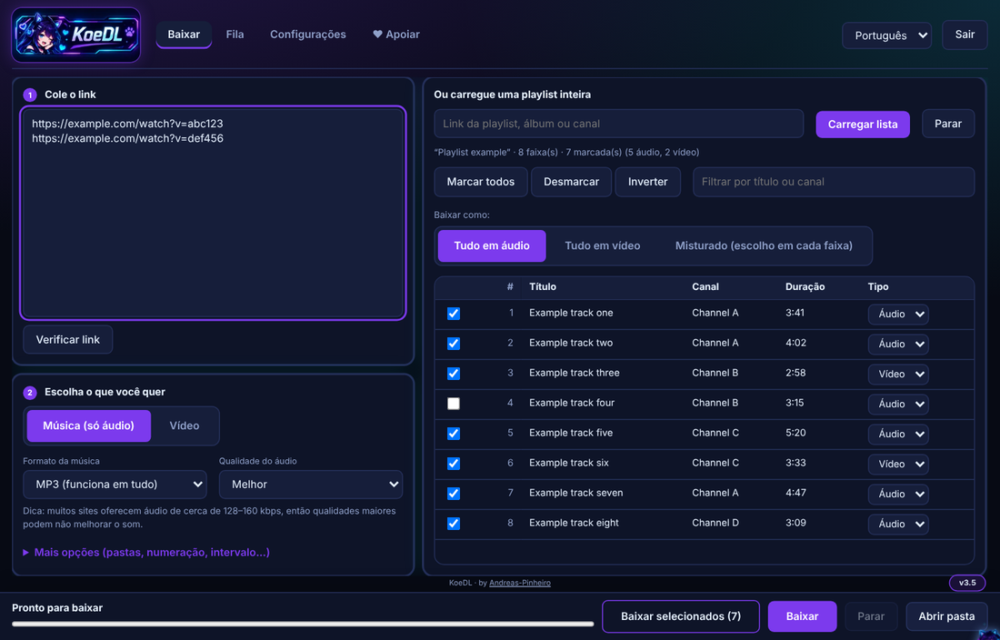
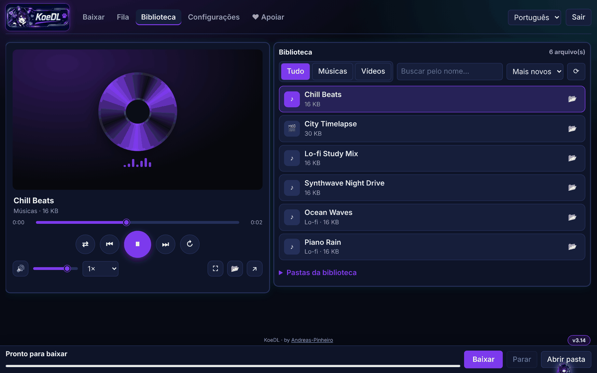
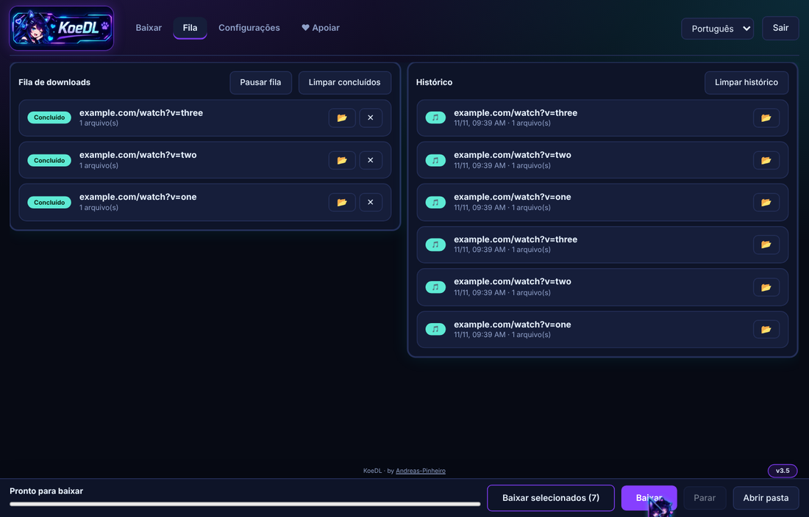
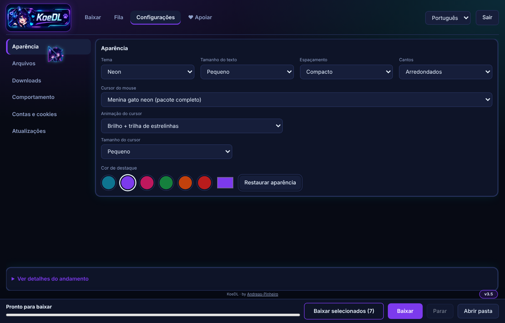
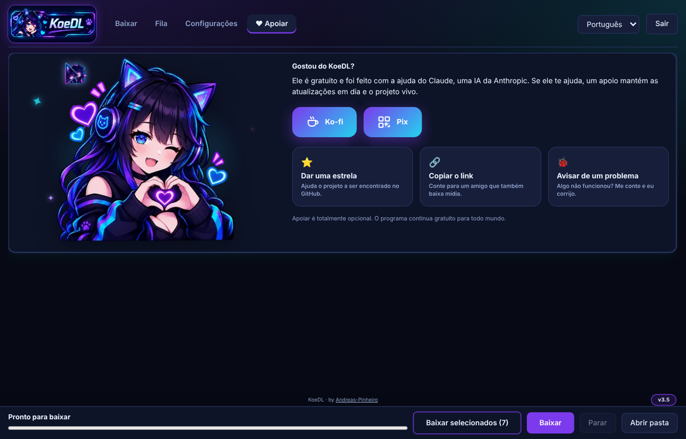

<p align="center"></p>

# KoeDL · Media-Downloader

Aplicativo para Windows que baixa vídeo e áudio de qualquer site suportado pelo [yt-dlp](https://github.com/yt-dlp/yt-dlp). Ele serve uma interface web local em janela própria e não precisa de Python.

[English](README.md)

> **Status:** desenvolvido e testado em Linux (backend em PowerShell 7 com yt-dlp, interface no Chromium). O teste em Windows é limitado: a geração do `.exe`, a leitura de cookies dos navegadores, o encerramento de processos e a criação de atalhos dependem do Windows e podem precisar de ajustes. Se algo falhar, abra uma issue com a mensagem de erro.

## Capturas de tela

<p align="center"></p>

<p align="center">





</p>

## O que faz

- **Música ou vídeo** de qualquer site suportado pelo [yt-dlp](https://github.com/yt-dlp/yt-dlp); veja a lista de sites dele.
- **Áudio:** MP3, M4A, Opus, FLAC ou WAV, com escolha de qualidade e capa e metadados embutidos.
- **Vídeo:** MP4 (H.264 + AAC) ou MKV (cópia do fluxo original, sem conversão), com limite de resolução opcional.
- **Playlists:** uma pasta com o nome da playlist (retomando de onde parou), uma pasta nova a cada execução (nome + data e hora) ou sem pasta. Vários links podem ser salvos numa pasta de lote com data e hora.
- **Painel de playlist** ao lado da caixa de links: cole links à esquerda e carregue uma playlist à direita, marque as faixas e defina áudio ou vídeo em cada uma. Subpastas Músicas / Vídeos opcionais.
- **Retomada:** arquivos já baixados são ignorados, com opção de recomeçar do zero.
- **Fila:** os downloads rodam um depois do outro, com pausar, remover e tentar de novo; é possível adicionar itens enquanto um download está em andamento.
- **Biblioteca e player:** lista os arquivos baixados e toca áudio e vídeo dentro do programa (capa, barra de progresso, volume, velocidade, aleatório, repetir, tela cheia, busca, filtro e ordenação). Também é possível adicionar outras pastas de música e vídeo. Formatos que o player interno não abre podem ser enviados ao player do Windows.
- **Converter:** extrai o áudio de arquivos de vídeo locais com o ffmpeg já incluído.
- **Histórico:** cada download concluído fica listado, com botão para mostrar o arquivo na pasta.
- **Configurações:** limite de velocidade e conexões por arquivo, pastas separadas para música e vídeo, e aviso do Windows, fechamento do programa ou desligamento do PC quando a fila termina.
- **Links:** o link copiado é colado automaticamente ao abrir, é possível arrastar links para a janela e há atalhos de teclado (Ctrl+Enter baixa, Ctrl+L foca o campo do link, Ctrl+1..5 trocam de aba).
- **Temas:** Neon (padrão), Meia-noite, Floresta, Sakura, claro e escuro, além de cores de destaque.
- **Downloads com falha:** uma versão alternativa é procurada e os itens sem solução são listados com o motivo.
- **Cookies:** rodízio entre Firefox, Edge, Chrome, Brave, Opera e Vivaldi, e também um arquivo `cookies.txt` ao lado do programa.
- **Atualizações:** o yt-dlp é atualizado a cada abertura (canal estável ou nightly); ffmpeg e deno são verificados periodicamente. Um download que falhou por extrator desatualizado é repetido após a atualização. Downloads de dependências são repetidos com esperas crescentes e um endereço alternativo.
- **Atalhos:** os atalhos da Área de Trabalho e do Menu Iniciar são criados na primeira execução. Fixar na barra de tarefas não é automatizado pelo Windows; use o botão direito no atalho > *Fixar na barra de tarefas*.
- **Atualização do próprio programa:** o programa consulta este repositório ao abrir e instala versões novas dele mesmo (`.bat` e `.exe`; pode ser desligado nas Configurações).
- **Idioma:** inglês e português, escolhido no cabeçalho e lembrado.
- **Geração do `.exe`:** ao abrir o `.bat`, o programa tenta gerar `KoeDL.exe` ao lado, com ícone e menu na bandeja do sistema. Um botão nas Configurações cria os atalhos da Área de Trabalho e do Menu Iniciar.

## Como usar

### Instalador (recomendado)

1. Abra a página de [**Releases**](https://github.com/Andreas-Pinheiro/KoeDL_Media_Downloader/releases/latest) e baixe o **`KoeDL-Setup.exe`** em *Assets*.
2. Execute o arquivo, escolha **Instalar no computador** ou **Versão portátil** e clique em **Instalar**.
3. Abra o **KoeDL** pela Área de Trabalho ou pelo Menu Iniciar. Na primeira execução ele baixa yt-dlp, ffmpeg e deno (é preciso internet).
4. Cole os links e clique em **Baixar**. Os arquivos são salvos na pasta `Downloads\KoeDL`, que pode ser alterada nas Configurações.

**Aviso do SmartScreen ou do antivírus:** os executáveis não têm assinatura digital, então o Windows pode exibir um aviso. Clique em **Mais informações** > **Executar assim mesmo**, ou confira o hash SHA-256 publicado com a release (veja *Conferir o arquivo baixado*).

### Arquivo único, sem instalação

Baixe o **`KoeDL.bat`** na mesma página de Releases, coloque numa pasta sua (por exemplo `C:\KoeDL`) e execute. O comportamento é o mesmo, e é a alternativa quando o `.exe` é bloqueado. O programa abre em janela própria (Microsoft Edge WebView2, baixado automaticamente se faltar); Edge ou Chrome em modo app é apenas uma alternativa. A janela lembra tamanho e posição.

Arquivos criados ao lado do programa (versão `.bat`): `bin\` (programas auxiliares, `settings.json`, histórico de downloads em `archives\`), `Downloads\` e, se gerado, o `.exe`.

## Requisitos

- Windows 10 ou 11 (64 bits).
- Internet na primeira execução (yt-dlp, ffmpeg e deno são baixados do GitHub) e para baixar mídia.
- Microsoft Edge WebView2 Runtime (incluído no Windows 11 e no Windows 10 atualizado; o instalador oferece baixá-lo se faltar).
- Sem Python, sem direitos de administrador (na pasta padrão) e sem outra instalação.

## Atualizar e desinstalar

- **Atualizar:** o programa verifica a última release do GitHub ao abrir e mostra o aviso **Atualizar agora**. Também é possível verificar em **Configurações > Atualizações**. Antes de aceitar uma atualização, o arquivo é comparado com o hash SHA-256 publicado na mesma release; se não bater, a atualização é ignorada.
- **Instalador:** baixe o `KoeDL-Setup.exe` mais recente e clique em **Atualizar**. Suas configurações, histórico e fila são mantidos; não é preciso desinstalar antes.
- **Desinstalar:** *Configurações do Windows > Aplicativos > KoeDL > Desinstalar*. Os downloads não são apagados. A versão portátil não tem desinstalador; apague a pasta.
- **Atualização manual:** baixe o `KoeDL-Setup.exe` (ou o `KoeDL.bat`) mais recente na página de Releases.

## Conferir o arquivo baixado

Cada release traz um `SHA256SUMS.txt` com o hash SHA-256 de cada arquivo (`KoeDL-Setup.exe`, `KoeDL.exe`, `KoeDL.bat`). Para conferir no PowerShell:

```powershell
Get-FileHash .\KoeDL-Setup.exe -Algorithm SHA256
```

O resultado deve ser igual ao hash publicado.

## Perguntas frequentes

**Funciona sem internet?** Só para tocar arquivos já baixados. Baixar e atualizar exigem internet.

**É seguro? Meu antivírus ou o Windows avisou.** Os executáveis são gerados pelo GitHub Actions a partir do código deste repositório e não têm assinatura digital, então o SmartScreen e alguns antivírus podem marcá-los como suspeitos. Compare o hash SHA-256 com o `SHA256SUMS.txt`; se o aviso continuar, use o `KoeDL.bat`, cujo código é legível. O código-fonte é público e pode ser auditado.

**Para onde vão os arquivos?** Para a pasta `Downloads` ao lado do programa (versão instalada: `Downloads\KoeDL` na sua pasta de usuário). Isso pode ser alterado nas Configurações, inclusive com pastas separadas para música e vídeo.

**Um vídeo não foi baixado.** Clique em **Configurações > Atualizar tudo** e tente de novo. Se continuar, abra uma issue com o link e o `bin\app.log`.

**Dá para usar em vários computadores?** Sim, com a versão portátil em um pendrive.

**O KoeDL coleta algum dado?** Não. Veja o [SECURITY.md](SECURITY.md).

**Dá para trocar o layout da interface?** Sim. **Configurações > Interface** alterna entre os layouts Clássico e Neon; a escolha é salva e a página recarrega.

## Instalador

O `KoeDL-Setup.exe` (da página de Releases) permite:

- **Instalar no computador** (atalhos, entrada em Aplicativos do Windows, desinstalador) ou a **versão portátil** (apenas copia os arquivos; nada é registrado no Windows).
- **Local de instalação:** a pasta padrão ou outra escolhida em *Procurar*.
- **Atualização:** uma instalação existente é detectada e substituída, mantendo configurações, histórico e fila.

> **Administrador:** a pasta padrão (dentro do seu perfil de usuário) não exige direitos de administrador. Uma pasta protegida, como `C:\Arquivos de Programas`, exige **botão direito no `KoeDL-Setup.exe` > Executar como administrador**; o instalador avisa e oferece reabrir com elevação.

## Gerar a partir do código

O `KoeDL.bat` de arquivo único é gerado a partir das fontes em `src/` (backend, interface, traduções, C#). Para refazê-lo:

```
python build/build.py          # reescreve KoeDL.bat e Media-Downloader.bat
python build/build.py --check  # falha se o .bat commitado não bate com src/
```

Ao enviar uma tag (por exemplo `v3.16.0`), o GitHub Actions (`.github/workflows/build.yml`) gera `KoeDL.bat`, `KoeDL.exe` e `KoeDL-Setup.exe`, cria o `SHA256SUMS.txt` e publica tudo na release, usando a seção correspondente do `CHANGELOG.md` como notas.

## Tecnologias

| Peça | Para quê |
|---|---|
| **Batch (`.bat`) + PowerShell 5.1** | Arquivo único: o `.bat` lê a si mesmo e executa a parte em PowerShell sem depender da política de execução de scripts |
| **PowerShell `HttpListener`** | Servidor web local (somente `127.0.0.1`, portas 8765–8789) com token por execução e verificação do cabeçalho `Host` |
| **Runspaces do PowerShell** | Downloads, leitura de playlist e atualizações em segundo plano, sem bloquear a interface |
| **HTML + CSS + JavaScript puros** | Interface embutida no próprio arquivo, tema claro e escuro automático, inglês e português |
| **[yt-dlp](https://github.com/yt-dlp/yt-dlp)** | Extração e download |
| **[FFmpeg](https://ffmpeg.org/)** (builds do yt-dlp) | Conversão, junção de áudio e vídeo e capa embutida |
| **[Deno](https://deno.com/)** | Execução do JavaScript exigido por alguns sites |
| **C# 5 + `CSharpCodeProvider` (.NET Framework)** | Compila o lançador `.exe` com ícone na bandeja na máquina do usuário |
| **WScript.Shell** | Criação de atalhos |

## Como funciona por dentro

- O `.bat` extrai o texto depois do marcador `###PS###` e o executa como bloco de script.
- Cada execução do yt-dlp usa um arquivo de configuração temporário em UTF-8, evitando problemas de aspas e acentos na linha de comando do Windows.
- O progresso vem de `--progress-template`; os arquivos concluídos, de `--exec`.
- O nome da pasta da playlist é resolvido antes do download, porque o yt-dlp substitui `/` dentro de campos do modelo de nome.
- O histórico (`--download-archive`) é separado por link e por formato/qualidade.
- A API local (`/api/...`) é protegida por token, o que deixa espaço para uma extensão de navegador ou um app com janela própria no futuro.

## Aviso legal

Use este programa apenas para baixar conteúdo que você tem o direito de baixar (seu, de domínio público, com licença que permita ou com autorização). Baixar certos conteúdos pode violar os termos de serviço dos sites ou leis de direitos autorais do seu país. A responsabilidade pelo uso é de quem usa. Este projeto não tem ligação com YouTube, Google ou qualquer outro site citado.

## Licença

[MIT](LICENSE). yt-dlp, FFmpeg e Deno têm licenças próprias.

## Créditos

O trabalho de download, conversão e execução de JavaScript é feito pelo [yt-dlp](https://github.com/yt-dlp/yt-dlp), pelo [FFmpeg](https://ffmpeg.org/) e pelo [Deno](https://deno.com/), cada um com sua licença. Este projeto apenas os orquestra.

---

Mantido por **[Andreas-Pinheiro](https://github.com/Andreas-Pinheiro)**.
